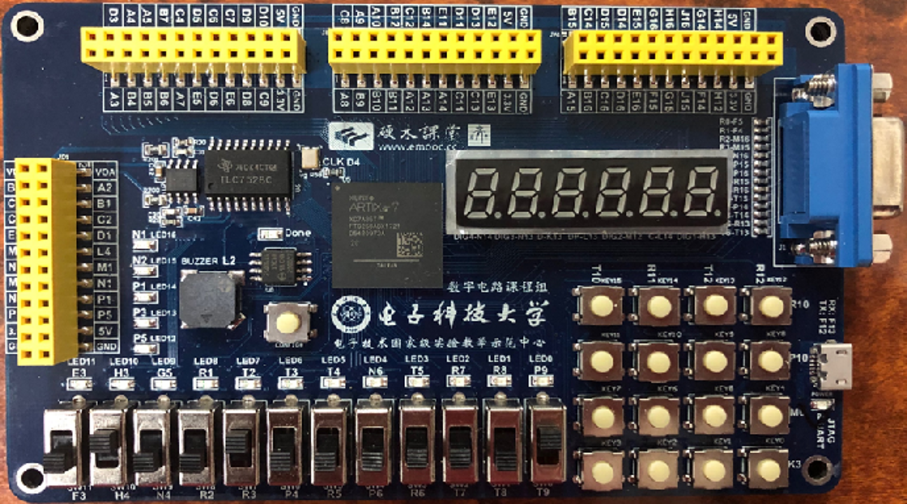

# FPGA 实验板资料参考（学校《数字系统实验II》）

> 本文档汇总本人所在学校《数字系统实验 II》课程所用 **Artix-7 实验板** 的完整引脚与片上资源约束，
> 全部来自《数字系统实验 II》课程各实验的官方 XDC / 源文件，
> 并结合本人实测交叉校验。后续本仓库 FPGA 工程（`firmware/coprocessors/fpga`）的引脚约束以本文为参考。

---

## 1. 板卡识别（务必看清，别用错芯片）

| 项 | 值 |
|---|---|
| FPGA 型号 | **XC7A35T-FTG256-1**（Artix-7，35T，256 脚 FTBGA，速度等级 -1） |
| 默认 I/O 标准 | **LVCMOS33**（3.3V，所有引脚约束都需加 `IOSTANDARD LVCMOS33`） |
| 主时钟 | **50 MHz**，晶振接 `D4` |
| 复位 | **低有效 `rst_n`**，接 `T9`（板上无上拉，设计中必须开内部 PULLUP） |

> Vivado 建工程时 **Project Type = RTL Project**，**Default Part** 选 `xc7a35tftg256-1`。

---

## 2. 时钟与复位（每个工程都必须有）

```tcl
## 50MHz 主时钟
set_property PACKAGE_PIN D4 [get_ports clk]
set_property IOSTANDARD  LVCMOS33 [get_ports clk]
create_clock -period 20.000 -name clk [get_ports clk]

## 复位（低有效）。板上无外部上拉，务必开内部 PULLUP，否则会一直卡在复位态
set_property PACKAGE_PIN T9 [get_ports rst_n]
set_property IOSTANDARD  LVCMOS33 [get_ports rst_n]
set_property PULLUP true [get_ports rst_n]
```

**实测注意**：本人最初写的 `top.v` 依赖 `rst_n`，结果下载成功（`End of startup status: HIGH`）但 LED 全不亮 —
原因是 `T9` 没被拉高，设计一直处于异步复位。加上 `PULLUP true` 或改用“不依赖外部复位”的诊断版后即正常。
**结论：rst_n 必须开内部上拉，或在逻辑里处理成可选。**

---

## 3. LED（16 颗，直接驱动，高电平点亮）

| 信号 | 引脚 | 信号 | 引脚 |
|---|---|---|---|
| `led[0]`  | **P9**  | `led[8]`  | **R1**  |
| `led[1]`  | **R8**  | `led[9]`  | **G5**  |
| `led[2]`  | **R7**  | `led[10]` | **H3**  |
| `led[3]`  | **T5**  | `led[11]` | **E3**  |
| `led[4]`  | **N6**  | `led[12]` | **P5**  |
| `led[5]`  | **T4**  | `led[13]` | **P1**  |
| `led[6]`  | **T3**  | `led[14]` | **N1**  |
| `led[7]`  | **T2**  | `led[15]` | **M1**  |

- 来源：课程《第六周 实验五（２）矩阵键盘按键控制 LED》约束文件（完整 16 颗）。
  课程 master 资源文件里只示范了 `Q[0..3]` + `CO`(N6)，其余以注释形式给出，与上面 16 颗完全一致。
- **极性**：实测为**高电平点亮**（直接驱动，非反相）。证据：`assign led = cnt[24:9]` 时
  `led[0..10]`（对应 `cnt[9..19]`，47 Hz~48.8 kHz）肉眼“常亮”，`led[11..15]` 随比特位升高频率递减 →
  说明每个 `led[k]` 直接接一个计数器高位，1=亮。
- ⚠️ **本板硬件缺陷（实测）**：`led[15]`（引脚 **M1**）在这块板子上**物理不亮**——
  同一份 1Hz 同步闪烁程序下 15 颗正常闪、唯独 M1 死暗。属于板卡个体硬件问题，**与工程/约束/下载无关**，验收时忽略即可。

---

## 4. UART（可用，master 中默认注释）

```tcl
# set_property PACKAGE_PIN F12 [get_ports txd]
# set_property IOSTANDARD  LVCMOS33 [get_ports txd]
# set_property PACKAGE_PIN F13 [get_ports rxd]
# set_property IOSTANDARD  LVCMOS33 [get_ports rxd]
```
- `txd → F12`，`rxd → F13`（LVCMOS33）。课程 master 资源文件里以 `#` 注释，需要时取消注释即可。

---

## 5. 矩阵键盘（按键 / 键盘扫描）

| 信号 | 引脚 | 信号 | 引脚 |
|---|---|---|---|
| `row[0]` | **K3** | `col[0]` | **R12** |
| `row[1]` | **M6** | `col[1]` | **T12** |
| `row[2]` | **P10** | `col[2]` | **R11** |
| `row[3]` | **R10** | `col[3]` | **T10** |

- 来源：master 资源文件 `##Buttons` +《第七周 实验六（２）电子琴》约束。
- ⚠️ **上拉/下拉不一致（官方两处写法不同）**：
  - 电子琴 XDC：`set_property PULLUP true [get_ports {col[3..0]}]`（列线上拉）
  - master 资源文件：`set_property PULLDOWN true [get_ports {col[3..0]}]`（列线下拉）
  - 实际用哪种取决于板子矩阵接法，本人未实测定论；**建议按键盘扫描惯例“列线输出、行线输入+上拉”对接，并在代码中做消抖**。

---

## 6. 拨码开关 `sw[0..11]`（与复位/数码管地址复用，注意冲突）

| 信号 | 引脚 | 信号 | 引脚 |
|---|---|---|---|
| `sw[0]`  | **T9**  | `sw[6]`  | **P4**  |
| `sw[1]`  | **T8**  | `sw[7]`  | **R3**  |
| `sw[2]`  | **T7**  | `sw[8]`  | **R2**  |
| `sw[3]`  | **R6**  | `sw[9]`  | **N4**  |
| `sw[4]`  | **P6**  | `sw[10]` | **H4**  |
| `sw[5]`  | **R5**  | `sw[11]` | **F3**  |

⚠️ **引脚复用冲突（务必注意）**：
- `T9` 同时是 **`rst_n`（复位）** 和 `sw[0]` —— 二者不能在同一工程里同时当独立信号用。
- `T8 / T7 / R6` 同时出现在数码管译码实验的 `ain[1] / ain[2] / ain[3]`（见第 7 节）。
- 同一工程要用开关又要用复位/数码管时，需分时复用或改接，不要简单把它们全部分配。

---

## 7. 数码管（7 段 × 6 位）

| 段信号 | 引脚 | 位选信号 | 引脚 |
|---|---|---|---|
| `seg[0]` | **P11** | `an/dig[0]` | **G12** |
| `seg[1]` | **N12** | `an/dig[1]` | **H13** |
| `seg[2]` | **L14** | `an/dig[2]` | **M12** |
| `seg[3]` | **K13** | `an/dig[3]` | **N13** |
| `seg[4]` | **K12** | `an/dig[4]` | **N14** |
| `seg[5]` | **P13** | `an/dig[5]` | **N11** |
| `seg[6]` | **M14** | 小数点 `dp` | **V7**（注释） |
| `seg[7]` | **L13** | | |

- 来源：master 资源文件 `##7 segment display` +《第二周 实验二（２）数码管》约束。
- master 用 `an[0..5]`，数码管实验用 `dig[0..5]`，**引脚完全相同**，仅为命名差异。
- 译码段码（共阴极，段选高电平亮）参考课程 `decoder_7seg`：
  `0→11111100, 1→01100000, 2→11011010, 3→11110010, 4→01100110, 5→10110110, 6→00111110, 7→11100000, 8→11111110, 9→11100110`。

---

## 8. 蜂鸣器与 DAC

**蜂鸣器**
```tcl
set_property PACKAGE_PIN L2 [get_ports buzzer]
set_property IOSTANDARD  LVCMOS33 [get_ports buzzer]
```
- 来源：电子琴实验 XDC。

**DAC（8 位）**
| 信号 | 引脚 | 信号 | 引脚 |
|---|---|---|---|
| `DAC_CS`  | **H2** | `DAC_DATA[0]` | **G1** |
| `DAC_WR`  | **H1** | `DAC_DATA[1]` | **G2** |
| `DACAB`   | **J3** | `DAC_DATA[2]` | **F2** |
| | | `DAC_DATA[3]` | **E1** |
| | | `DAC_DATA[4]` | **L3** |
| | | `DAC_DATA[5]` | **K1** |
| | | `DAC_DATA[6]` | **K2** |
| | | `DAC_DATA[7]` | **J1** |

- 来源：master 资源文件 `##DAC`（全部以注释形式给出）。

---

## 9. 实测记录（2026-10，本人验证）

1. **下载成功标志**：Vivado `Program Device` 日志末尾出现 `End of startup status: HIGH` ⇒ 比特流已配置、DONE 拉高、设计在运行。
2. **时钟验证法**：把 25 位计数器 `cnt` 的高 16 位直接接 `led`（`assign led = cnt[24:9]`），
   若 LED0~10 常亮、11~15 频率递减 ⇒ 证明 50MHz/D4 时钟在跑、led 引脚全对。
3. **坏 LED**：`led[15]=M1` 在本板物理不亮（见 §3 警告），非工程问题。
4. **复位坑**：`rst_n`(T9) 不开内部上拉时设计卡复位，LED 全灭；加 `PULLUP true` 解决。

---

## 10. 最小可复用 XDC（时钟 + 复位 + 16 LED）

新建工程后，把下面内容直接贴进 `pins.xdc`（按需再补 UART / 键盘 / 数码管 / DAC）：

```tcl
## Clock: 50MHz on D4
set_property PACKAGE_PIN D4 [get_ports clk]
set_property IOSTANDARD  LVCMOS33 [get_ports clk]
create_clock -period 20.000 -name clk [get_ports clk]

## Reset (active-low). Board has NO pull-up -> enable internal PULLUP
set_property PACKAGE_PIN T9 [get_ports rst_n]
set_property IOSTANDARD  LVCMOS33 [get_ports rst_n]
set_property PULLUP true [get_ports rst_n]

## 16 LEDs (led[15]=M1 is physically dead on this board)
set_property PACKAGE_PIN P9  [get_ports {led[0]}]
set_property PACKAGE_PIN R8  [get_ports {led[1]}]
set_property PACKAGE_PIN R7  [get_ports {led[2]}]
set_property PACKAGE_PIN T5  [get_ports {led[3]}]
set_property PACKAGE_PIN N6  [get_ports {led[4]}]
set_property PACKAGE_PIN T4  [get_ports {led[5]}]
set_property PACKAGE_PIN T3  [get_ports {led[6]}]
set_property PACKAGE_PIN T2  [get_ports {led[7]}]
set_property PACKAGE_PIN R1  [get_ports {led[8]}]
set_property PACKAGE_PIN G5  [get_ports {led[9]}]
set_property PACKAGE_PIN H3  [get_ports {led[10]}]
set_property PACKAGE_PIN E3  [get_ports {led[11]}]
set_property PACKAGE_PIN P5  [get_ports {led[12]}]
set_property PACKAGE_PIN P1  [get_ports {led[13]}]
set_property PACKAGE_PIN N1  [get_ports {led[14]}]
set_property PACKAGE_PIN M1  [get_ports {led[15]}]
set_property IOSTANDARD LVCMOS33 [get_ports {led[15]}]
set_property IOSTANDARD LVCMOS33 [get_ports {led[14]}]
set_property IOSTANDARD LVCMOS33 [get_ports {led[13]}]
set_property IOSTANDARD LVCMOS33 [get_ports {led[12]}]
set_property IOSTANDARD LVCMOS33 [get_ports {led[11]}]
set_property IOSTANDARD LVCMOS33 [get_ports {led[10]}]
set_property IOSTANDARD LVCMOS33 [get_ports {led[9]}]
set_property IOSTANDARD LVCMOS33 [get_ports {led[8]}]
set_property IOSTANDARD LVCMOS33 [get_ports {led[7]}]
set_property IOSTANDARD LVCMOS33 [get_ports {led[6]}]
set_property IOSTANDARD LVCMOS33 [get_ports {led[5]}]
set_property IOSTANDARD LVCMOS33 [get_ports {led[4]}]
set_property IOSTANDARD LVCMOS33 [get_ports {led[3]}]
set_property IOSTANDARD LVCMOS33 [get_ports {led[2]}]
set_property IOSTANDARD LVCMOS33 [get_ports {led[1]}]
set_property IOSTANDARD LVCMOS33 [get_ports {led[0]}]
```

---

## 11. 板子照片

实验板实物照片（来自课程目录，已存入仓库）：



> 原图：`D:\Users\DerekWang\Documents\学校\理工\数字系统实验II\FPGA开发板 Artix-7 xc7a35tftg256-1.png`
> 官方原理图暂未纳入仓库；取得后可补在 `hardware/schematics/` 并此处引用。
